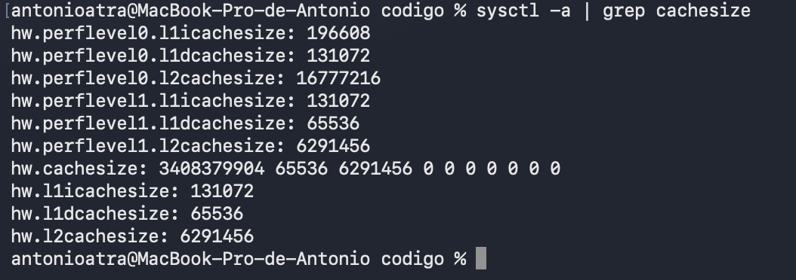
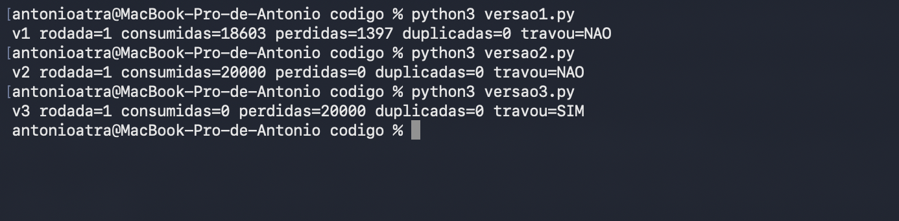

Antonio Augusto Tavares Ribeiro André — D1 = 7; D2 = 3; N = 6

# Ponderada Computação CC08: do pipeline ao deadlock

**Aluno:** Antonio Augusto Tavares Ribeiro André  
**Parâmetros:** primeiro nome `Antonio` = 7 letras; nome completo = 7 + 7 + 7 + 7 + 5 = 33 letras; `D1 = 7`, `D2 = 33 mod 10 = 3`, `N = 3 + (3 mod 5) = 6`.  
**Cenário:** pulseira sensorial Tato, 100 amostras/s (intervalo de 10 ms), prazo máximo de processamento de **5 ms por amostra**.

# Parte A — O problema técnico

## A1. Arquitetura e memória

### Parâmetros

- Instruções por amostra: `IC = 100.000 + 20.000 × D2 = 160.000`.
- Taxa de falta da cache L1 de V: `m = 3% + 0,5% × D1 = 6,5% = 0,065`.

### 1. Plataforma H: Harvard, 48 MHz

`Tempo_H = IC × CPI / clock = (160.000 × 1,5)/(48 × 10⁶) = 0,005 s = 5,000 ms`.

**Conclusão:** atende exatamente o limite de 5 ms.

### 2. Plataforma V: Von Neumann, 1,2 GHz, Linux

Taxa de falta por acesso de memória: `m = 0,065`; penalidade de falta: 120 ciclos; tempo de acerto: 1 ciclo.

AMAT:
`AMAT = tempo de acerto + m × penalidade de falta = 1 + 0,065 × 120 = 8,8 ciclos por acesso`.

CPI efetivo
`CPI_efetivo = 1,0 + (1,3 × 0,065 × 120) = 1 + 10,14 = 11,14`.

`Tempo_V = (160.000 × 11,14)/(1,2 × 10⁹) = 0,00148533 s ≈ 1,485 ms`.

`Tempo_V,pior = 1,48533 + 3,000 = 4,48533 ms`.

**Conclusão:** atende os 5 ms no pior caso, com folga de aproximadamente `5 − 4,48533 = 0,515 ms`. 

### 3. Acelerador DSP na H (Lei de Amdahl)

Fração acelerada `p = 0,60`; aceleração da fração `s = 5`:

`S = 1 / [(1−p) + p/s] = 1 / (0,40 + 0,60/5) = 1 / 0,52 ≈ 1,9231`.

`Tempo_H+DSP = 5,000/1,9231 = 2,600 ms`.

**Conclusão:** atende o requisito com folga de `5 − 2,6 = 2,4 ms`, segundo as hipóteses do exercício.

| Plataforma | Tempo por amostra | Folga até 5 ms | Atende? |
|---|---:|---:|---|
| H | 5,000 ms | 0,000 ms | Sim, no limite |
| V (pior caso dado) | 4,485 ms | 0,515 ms | Sim |
| H + DSP | 2,600 ms | 2,400 ms | Sim |

### 4. Cache e gargalo de Von Neumann (até cinco linhas)

Na plataforma V, instruções e dados disputam o caminho até a DRAM externa, mais lenta que a CPU de 1,2 GHz.  
A cache L1 reduz o custo médio desses acessos e alivia o gargalo de Von Neumann.  
A plataforma H separa o acesso a instruções e dados, usa SRAM interna com acesso em um ciclo e opera a 48 MHz.  
Assim, no modelo proposto, H não precisa de cache para manter o fluxo de execução.

### 5. Evidência das caches do computador

Saída de `sysctl -a | grep cachesize` no MacBook Pro (Apple M5):



| Núcleos | L1 instruções | L1 dados | L2 (compartilhada) |
|---|---:|---:|---:|
| Desempenho (`perflevel0`) | 192 KB (196.608 B) | 128 KB (131.072 B) | 16 MB (16.777.216 B) |
| Eficiência (`perflevel1`) | 128 KB (131.072 B) | 64 KB (65.536 B) | 6 MB (6.291.456 B) |

**A L1 é dividida?** Sim: em ambos os tipos de núcleo há uma L1 só de instruções (`l1icachesize`) e outra só de dados (`l1dcachesize`). Já a L2 e a memória principal são unificadas.

**Von Neumann ou Harvard?** O computador é **Von Neumann**, com **organização Harvard modificada no nível da L1**. Instruções e dados residem na mesma memória principal e no mesmo espaço de endereçamento (por isso é possível carregar um programa como dado e executá-lo), característica de Von Neumann. A separação I/D existe apenas na L1, para que busca de instrução e acesso a dado ocorram no mesmo ciclo, atenuando o gargalo de Von Neumann descrito no item 4.

## A2. Pipeline: o loop do filtro

Instruções originais:

```asm
1  lw   x5, 0(x10)     # lê amostra nova
2  add  x6, x6, x5     # soma += nova
3  lw   x7, 0(x11)     # lê amostra antiga
4  sub  x6, x6, x7     # soma -= antiga
5  sw   x6, 0(x12)     # armazena soma
6  addi x10, x10, 4    # avança ponteiro da nova
7  addi x11, x11, 4    # avança ponteiro da antiga
```

### 1. Dependências RAW

| Produtora → consumidora | Registrador | Por que existe |
|---|---|---|
| I1 → I2 | x5 | `add` usa a amostra lida por `lw` |
| I2 → I4 | x6 | `sub` subtrai do valor atualizado pela soma |
| I3 → I4 | x7 | `sub` usa a amostra antiga carregada |
| I4 → I5 | x6 | `sw` grava o resultado final |

Também há dependência transitiva I2 → I5 em `x6`; a dependência direta mais recente que determina o valor a gravar é I4 → I5. Os ponteiros `x10` e `x11` são lidos pelos loads e depois modificados por I6/I7, configurando **antidependências (WAR)** a preservar na reordenação, não RAW dentro deste trecho. Assumimos que os endereços de `sw` e `lw` não se sobrepõem de forma a alterar os valores lidos.

### 2. Pipeline **sem forwarding**

Adota-se pipeline em ordem `IF → ID → EX → MEM → WB`. Uma instrução consumidora só lê um registrador em `ID` quando a produtora já está em `WB` (escrita na primeira metade, leitura na segunda). `ID*` é um ciclo de espera da instrução em ID, bloqueando o avanço do IF.

| Instrução | 1 | 2 | 3 | 4 | 5 | 6 | 7 | 8 | 9 | 10 | 11 | 12 | 13 | 14 | 15 | 16 | 17 |
|:--|:--:|:--:|:--:|:--:|:--:|:--:|:--:|:--:|:--:|:--:|:--:|:--:|:--:|:--:|:--:|:--:|:--:|
| 1 lw x5 | IF | ID | EX | MEM | WB | · | · | · | · | · | · | · | · | · | · | · | · |
| 2 add x6 | · | IF | ID* | ID* | ID | EX | MEM | WB | · | · | · | · | · | · | · | · | · |
| 3 lw x7 | · | · | · | · | IF | ID | EX | MEM | WB | · | · | · | · | · | · | · | · |
| 4 sub x6 | · | · | · | · | · | IF | ID* | ID* | ID | EX | MEM | WB | · | · | · | · | · |
| 5 sw x6 | · | · | · | · | · | · | · | · | IF | ID* | ID* | ID | EX | MEM | WB | · | · |
| 6 addi x10 | · | · | · | · | · | · | · | · | · | · | · | IF | ID | EX | MEM | WB | · |
| 7 addi x11 | · | · | · | · | · | · | · | · | · | · | · | · | IF | ID | EX | MEM | WB |


**Total: 17 ciclos**, do primeiro IF (ciclo 1) ao último WB (ciclo 17). As dependências RAW forçam 2 esperas em I2, 2 em I4 e 2 em I5: 6 bolhas além dos 11 ciclos ideais.

### 3. Pipeline **com forwarding**

Assume-se encaminhamento de operandos de ALU e de dados do `store` para o estágio onde são utilizados. Ainda é preciso uma bolha quando a instrução imediatamente seguinte depende de um `lw`, porque o dado só fica disponível após MEM.

| Instrução | 1 | 2 | 3 | 4 | 5 | 6 | 7 | 8 | 9 | 10 | 11 | 12 | 13 |
|:--|:--:|:--:|:--:|:--:|:--:|:--:|:--:|:--:|:--:|:--:|:--:|:--:|:--:|
| 1 lw x5 | IF | ID | EX | MEM | WB | · | · | · | · | · | · | · | · |
| 2 add x6 | · | IF | ID* | ID | EX | MEM | WB | · | · | · | · | · | · |
| 3 lw x7 | · | · | · | IF | ID | EX | MEM | WB | · | · | · | · | · |
| 4 sub x6 | · | · | · | · | IF | ID* | ID | EX | MEM | WB | · | · | · |
| 5 sw x6 | · | · | · | · | · | · | IF | ID | EX | MEM | WB | · | · |
| 6 addi x10 | · | · | · | · | · | · | · | IF | ID | EX | MEM | WB | · |
| 7 addi x11 | · | · | · | · | · | · | · | · | IF | ID | EX | MEM | WB |


**Total: 13 ciclos.** Permanecem duas bolhas *load-use*: I1 → I2 por `x5` e I3 → I4 por `x7`. O encaminhamento contorna as demais RAW, inclusive a passagem de `x6` para `sw`.

### 4. Reordenação para eliminar bolhas com forwarding

```asm
1  lw   x5, 0(x10)
3  lw   x7, 0(x11)
2  add  x6, x6, x5
6  addi x10, x10, 4
4  sub  x6, x6, x7
7  addi x11, x11, 4
5  sw   x6, 0(x12)
```

A leitura em I1 antecede a atualização de `x10` em I6, e I3 antecede I7, preservando o endereço das leituras. A soma é feita antes da subtração; a gravação ocorre após ambas. As instruções independentes ocupam os espaços anteriormente ociosos.

| Instrução | 1 | 2 | 3 | 4 | 5 | 6 | 7 | 8 | 9 | 10 | 11 |
|:--|:--:|:--:|:--:|:--:|:--:|:--:|:--:|:--:|:--:|:--:|:--:|
| 1 lw x5 | IF | ID | EX | MEM | WB | · | · | · | · | · | · |
| 3 lw x7 | · | IF | ID | EX | MEM | WB | · | · | · | · | · |
| 2 add x6 | · | · | IF | ID | EX | MEM | WB | · | · | · | · |
| 6 addi x10 | · | · | · | IF | ID | EX | MEM | WB | · | · | · |
| 4 sub x6 | · | · | · | · | IF | ID | EX | MEM | WB | · | · |
| 7 addi x11 | · | · | · | · | · | IF | ID | EX | MEM | WB | · |
| 5 sw x6 | · | · | · | · | · | · | IF | ID | EX | MEM | WB |


**Total: 11 ciclos = 7 instruções + 4 ciclos para encher/esvaziar o pipeline**, sem bolhas, sob o modelo assumido. A reordenação é válida para as dependências de registradores e para acessos independentes aos endereços de memória; não seria automaticamente segura caso os endereços aliassem entre si ou houvesse efeitos externos de E/S.

## A3. Processos e threads

### 1. Organização proposta

```text
PROCESSO CRÍTICO: controle da pulseira
  ├─ Thread sensor: lê a cada 10 ms
  ├─ Thread processamento: filtra e transforma distância em intensidade
  └─ Thread motor: aplica vibração indicada
       memória compartilhada + buffer sincronizado

PROCESSO ISOLADO: comunicação BLE
  ├─ recebe comandos de configuração
  └─ transmite logs para o celular
       IPC com o processo crítico (fila/socket local)
```

As três threads críticas compartilham amostras e parâmetros com baixo custo de troca de contexto e comunicação, o que favorece o prazo de 5 ms. Entretanto, acesso simultâneo ao buffer exige sincronização e políticas de prioridade. BLE fica em um **processo separado**, pois recebe entradas externas e não precisa ter acesso irrestrito à memória do controle sensorial. A separação traz custo de IPC e de processos adicionais, mas melhora o isolamento de falhas; o caminho sensor → motor não deve depender de BLE. A criação de threads/processos ocorre na inicialização, não a cada amostra.

### 2. Consequência de exploração no BLE

Como thread no processo principal, código BLE explorado pode ter acesso ao espaço de endereçamento compartilhado e corromper buffers, configurações e respostas do motor; uma falha grave pode encerrar o processo inteiro. Em processo isolado, há uma fronteira de memória e permissões: uma invasão do BLE não fornece automaticamente acesso ao processo crítico, embora vulnerabilidades no IPC ou no sistema operacional ainda sejam riscos. A arquitetura deve validar comandos e limitar privilégios.

### 3. Estados do processo e thread do sensor

```text
                 escalonamento
     PRONTO ----------------------> EXECUÇÃO
       ^                               |
       |                               | espera I/O, timer, evento
       |                               v
       +--------- ESPERA / BLOQUEADO <-+
               evento concluído

EXECUÇÃO --preempção/fim de quantum--> PRONTO
```

A thread do sensor passa **a maior parte do tempo em espera/bloqueada** por temporizador ou evento: obtém uma amostra a cada 10 ms e, em princípio, gasta muito menos tempo na leitura que aguardando o próximo período. Uma thread é escalonada individualmente; o processo pode continuar ativo por meio das outras threads. O ideal é usar espera por evento/temporizador, não espera ocupada, no software real.

## A4. Código com semáforos: buffer entre sensor e motor

Arquivos completos: `codigo/versao1.py`, `codigo/versao2.py`, `codigo/versao3.py` e utilitário `codigo/comum.py`. Todos trabalham com `N = 6` e `TOTAL = 20.000`, com uma execução por comando. Cada versão foi executada três vezes no ambiente Python 3 deste trabalho; os resultados são de execuções reais, mas a ordem de escalonamento pode fazer as métricas da versão 1 variarem entre máquinas.

### 1. Resultados das nove execuções

| Versão | Rodada | Consumidas | Perdidas | Duplicadas | Travou? |
|---|---:|---:|---:|---:|---|
| 1 | 1 | 18908 | 1092 | 0 | NAO |
| 1 | 2 | 19023 | 977 | 0 | NAO |
| 1 | 3 | 19197 | 803 | 0 | NAO |
| 2 | 1 | 20000 | 0 | 0 | NAO |
| 2 | 2 | 20000 | 0 | 0 | NAO |
| 2 | 3 | 20000 | 0 | 0 | NAO |
| 3 | 1 | 0 | 20000 | 0 | SIM |
| 3 | 2 | 0 | 20000 | 0 | SIM |
| 3 | 3 | 0 | 20000 | 0 | SIM |

**Definições:** `consumidas` = número de retiradas válidas registradas pelo consumidor; `perdidas` = IDs esperados de 0 a 19.999 não observados no consumo; `duplicadas` = ocorrências de IDs válidos acima da primeira; `travou` = alguma thread ainda não tinha terminado ao fim do tempo limite (1 s na versão 3; 10 s nas versões 1 e 2). Na versão 3, "perdidas" significa **não entregues devido ao travamento**, e não necessariamente sobrescritas no buffer: seis itens podem permanecer armazenados.

### 2. Evidências dos testes

Print do Terminal com uma execução de cada versão:



Na versão 1, a quantidade de perdas muda a cada execução, porque depende de como o sistema escalona as threads. Isso reforça a condição de corrida descrita no item 3. As versões 2 e 3 repetem exatamente o comportamento da tabela: 20.000 consumidas sem perdas, e travamento sem nenhum consumo, respectivamente.

Texto integral das nove saídas da tabela: `img/execucoes_reais.txt`.

### 3. Versão 1 — Região crítica e condição de corrida

A região crítica inclui a inserção/retirada no vetor circular, atualização dos índices de leitura/escrita e especialmente a sequência **ler contador → `sleep(0)` → escrever contador**. O contador `ocupadas` é compartilhado e incrementos/decrementos não são protegidos; produtor e consumidor podem ler um valor antigo e gravar resultados incompatíveis. Isso rompe a correspondência entre contador e conteúdo do buffer, permitindo sobreposição de posições, consumo de item ausente, perdas ou leituras repetidas conforme o interleaving. A execução observada perdeu IDs e **não registrou duplicatas**: isso não significa que a implementação seja segura. Sem semáforos, as threads usam espera ocupada: ficam testando o contador em laço, com `sleep(0)`, até haver vaga ou item.

### 4. Versão 2 — Os três semáforos

- `vazio = Semaphore(N)` inicia com **6 permissões**; produtor só escreve se houver espaço.
- `cheio = Semaphore(0)` inicia sem permissões; consumidor só retira depois de existir item publicado.
- `mutex = Semaphore(1)` garante **exclusão mútua** durante acesso e atualização do buffer/índices.

Sequência correta do produtor: `wait(vazio) → wait(mutex) → inserir → signal(mutex) → signal(cheio)`. Consumidor: `wait(cheio) → wait(mutex) → retirar → signal(mutex) → signal(vazio)`. A ordem evita segurar `mutex` enquanto se espera disponibilidade de espaço ou item. Nos testes, todas as 20.000 amostras foram consumidas sem perda, duplicação ou travamento.

### 5. Versão 3 — Ordem trocada e deadlock

O produtor executa `wait(mutex)` **antes** de `wait(vazio)`. Se o buffer está cheio, ele adquire o mutex e fica esperando uma vaga. O consumidor já pode obter `cheio`, mas precisa do `mutex` retido pelo produtor para retirar uma amostra e liberar `vazio`. Forma-se o ciclo `produtor → vazio → consumidor → mutex → produtor`. Para que o deadlock seja reproduzível, o consumidor espera 0,1 s antes de começar: nesse intervalo o produtor enche as seis posições e fica preso na sétima, segurando o mutex. **O escalonamento foi deliberadamente forçado**; sem esse atraso, o travamento depende de o buffer encher antes de o consumidor pegar o mutex. Nas três rodadas controladas, ocorreu deadlock antes de qualquer consumo. As threads são `daemon` para que o programa consiga encerrar e imprimir o resultado mesmo com elas travadas.

## A5. Deadlock: a pulseira congelou

### 1. Sequência e grafo de alocação

Considere os recursos binários exclusivos `I2C`, `LOG` e `BLE`:

1. `thread_sensor` executa `P(i2c)` e adquire **I2C**.
2. `thread_log` executa `P(log)` e adquire **LOG**.
3. `thread_config` executa `P(ble)` e adquire **BLE**.
4. `thread_sensor` tenta `P(log)` e bloqueia, pois LOG está com `thread_log`.
5. `thread_log` tenta `P(ble)` e bloqueia, pois BLE está com `thread_config`.
6. `thread_config` tenta `P(i2c)` e bloqueia, pois I2C está com `thread_sensor`.

```text
I2C ──atribuição──> SENSOR ──solicitação──> LOG
 ^                                          |
 |                                      atribuição
 |                                          v
 |                                       LOG_THREAD
 |                                          |
 |                                      solicitação
 |                                          v
CONFIG <──atribuição── BLE <─────────────────┘
  |
  └──────────── solicitação ────────────────> I2C
```


**Leitura correta do grafo de alocação (arestas):** `I2C → SENSOR`, `SENSOR → LOG`, `LOG → LOG_THREAD`, `LOG_THREAD → BLE`, `BLE → CONFIG`, `CONFIG → I2C`. Seta recurso → thread é atribuição; seta thread → recurso é solicitação.

### 2. Quatro condições necessárias

1. **Exclusão mútua:** I2C, LOG e BLE são protegidos por semáforos de acesso exclusivo.
2. **Posse e espera:** cada thread segura um recurso enquanto solicita o próximo.
3. **Sem preempção:** os semáforos não são retirados automaticamente de quem os adquiriu.
4. **Espera circular:** `SENSOR → LOG_THREAD → CONFIG → SENSOR`.

### 3. Duas correções diferentes

**Correção A — prevenção pela ordem global de aquisição:** definir ordem `I2C < LOG < BLE`. `thread_sensor` adquire I2C, depois LOG (já atende); `thread_log` adquire LOG, depois BLE (já atende); `thread_config` passa a adquirir I2C **antes** de BLE, invertendo a ordem original nessa thread. Liberar os recursos sempre que a operação terminar, preferencialmente em ordem reversa. Isso elimina a espera circular, embora possa aumentar espera por I2C e exigir reestruturação de código. Para quem usa, a prevenção diminui o risco de congelamento; o custo é uma possível latência adicional, que deve ser medida para manter o limite de 5 ms.

**Correção B — detecção e recuperação por timeout:** instrumentar aquisição de semáforos com limite de espera, identificar ciclo por grafo de espera/telemetria e abortar uma operação que ainda não tenha produzido efeitos irreversíveis, liberando seus semáforos em `finally` e tentando novamente em ordem segura. Não "liberar" um mutex pertencente a outra thread à força. Durante recuperação, o sistema deve priorizar o caminho crítico do sensor e indicar o estado de falha de forma inequívoca; pode haver atraso ou indisponibilidade temporária de vibração. Um watchdog pode reiniciar um sistema completamente travado, mas implica uma janela sem orientação e não corrige a causa.

# Parte B — Memorando ao conselho da Tato (Dilema 3)

**Decisão: o módulo de navegação do parceiro vai rodar como processo separado, conversando com o nosso software por comunicação entre processos (IPC), e não como thread dentro do nosso processo principal.**

**Para:** Conselho da Tato  
**De:** CTO  
**Assunto:** Proposta do parceiro de navegação

A latência extra do processo separado não pesa na navegação. Os avisos do parceiro são em metros ("vire à direita em 20 m"), e a comunicação entre processos acrescenta poucos milissegundos. Uma pessoa caminhando a cerca de 1 m/s anda 1 cm em 10 ms, uma diferença imperceptível diante de um aviso a 20 m. A latência que não pode piorar é a do alerta de obstáculos, e esse caminho (sensor → processamento → motor) não passa pelo módulo do parceiro.

O número que mais pesou foi a folga da Plataforma V, a única que tem sistema operacional para rodar processos separados. Na A1 ela leva **4,485 ms no pior caso**, uma folga de apenas **0,515 ms** dentro do limite de 5 ms. Com uma margem tão pequena, não posso colocar código fechado, que não conseguimos inspecionar, dentro do mesmo processo do caminho crítico, com acesso direto à memória e às amostras. Um laço mal feito ou um travamento desse código atrasaria ou congelaria a vibração de obstáculo. Como processo separado, o sistema operacional isola o módulo e permite dar a ele prioridade menor que a do nosso caminho crítico.

**Do que abro mão:** do risco real de o parceiro desistir e de perdermos a distribuição para 50 mil usuários. Quem paga esse custo é a Tato, que deixa de crescer por esse canal, e as pessoas que receberiam a pulseira por meio dele. Pagamos também o desenvolvimento e a manutenção da interface IPC. E a comunicação entre processos é trabalho extra que não existiria com a thread: cada mensagem precisa ser copiada e passar pelo sistema operacional, consumindo parte da mesma folga de 0,515 ms. Em troca, ganhamos o que a thread não oferece, que é o sistema operacional dar ao módulo do parceiro prioridade menor que a do alerta de obstáculos.

**Impacto e segurança:** para quem usa, a navegação chega alguns milissegundos depois, sem diferença perceptível, e o alerta de obstáculos fica independente dela. Se o módulo do parceiro travar ou falhar, a pulseira continua avisando do poste à frente. Na segurança, o código fechado não terá acesso às amostras nem à memória do controle. Uma falha ou invasão nele, que se comunica com o celular e com os servidores do parceiro, fica contida no processo dele. O risco que sobra está no canal IPC: toda mensagem precisa ser validada, o parceiro só pode pedir o que for necessário para a navegação, e os dados enviados a ele, como a localização, devem ser os mínimos.

**O que me faria mudar de ideia:** hoje o parceiro diz que *pode* desistir, o que é uma ameaça de negociação, não um fato, e por isso mantenho a decisão e defendo os números acima. Mudo de ideia se o parceiro formalizar, por escrito, que o acordo está encerrado caso o módulo não rode como thread. Nesse caso, aceito a thread com duas condições: que testes no hardware mostrem **todas as amostras abaixo de 5 ms** com o módulo rodando junto e que o parceiro permita auditarmos o código antes do lançamento. Se for preciso um processador mais potente para garantir os 5 ms, o aumento no custo da pulseira entra na negociação do acordo.
